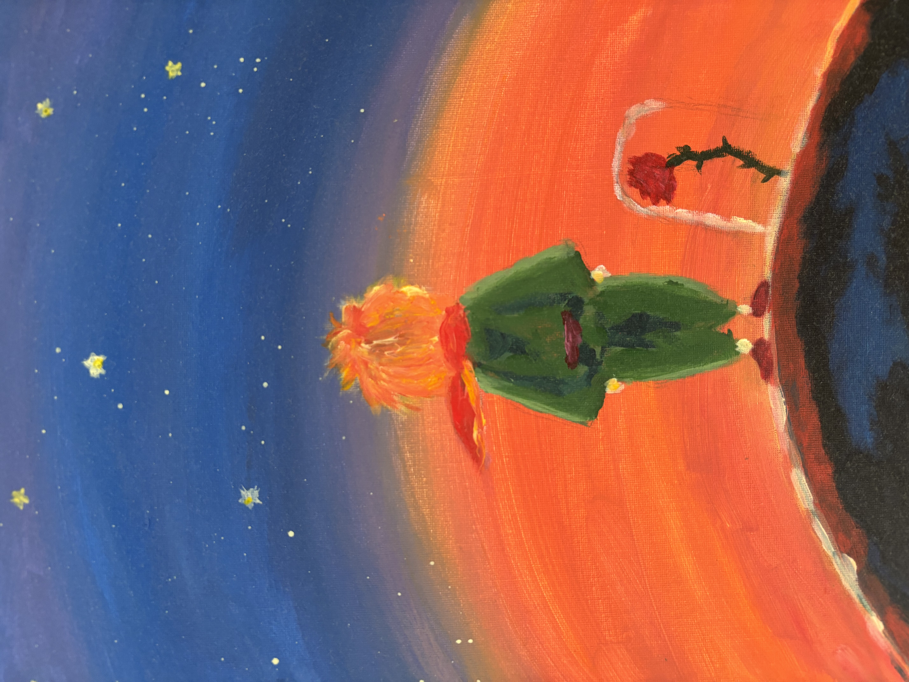
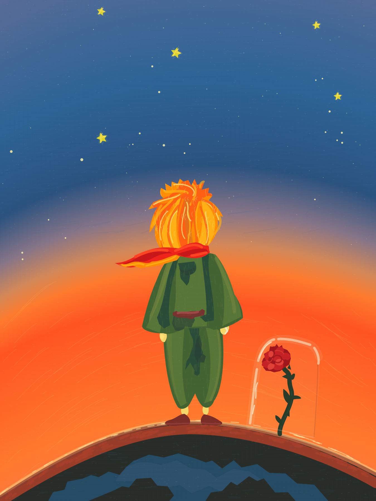

# One-Shot TikZ Drawing

A collection of standalone TikZ drawings based on reference images, each started from a single creation prompt. Each drawing folder contains its LaTeX source, compiled PDF, preview, original prompt, and model attribution.

## Current drawing

[The Little Prince in TikZ](img_4707_tikz/README.md): a recreation of the reference painting in `IMG_4707.jpeg`.

| Original reference | TikZ drawing |
| --- | --- |
|  |  |

## Files

| File or folder | What it is |
| --- | --- |
| [IMG_4707.jpeg](IMG_4707.jpeg) | Original reference image, with personal metadata removed. |
| [img_4707_tikz/](img_4707_tikz/) | Standalone drawing source, PDF, PNG preview, and prompt/model README. |
| [README.md](README.md) | Collection overview and file guide. |
| [.gitignore](.gitignore) | Excludes temporary LaTeX build files and macOS metadata from Git. |

The reference image is one level above its drawing folder. The TikZ source compiles independently of the image.

## Build

Use a TeX distribution with TikZ and the `standalone` class installed:

```sh
cd img_4707_tikz
pdflatex -interaction=nonstopmode -halt-on-error IMG_4707.tex
```
